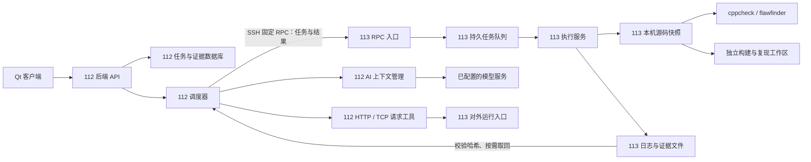
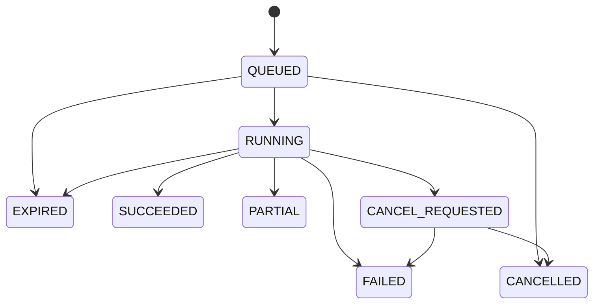

> **历史备选方案，当前不采用（2026-10-11）**：用户已确定采用 112 集中源码扫描、113 保持现有部署。本文描述的 113 本机执行器未实现，也不是部署前提。当前实现和验收以 [源码扫描与 Playbook 集成设计](source-assisted-testing.md) 为准。

# C/C++ 源代码扫描与验证：113 本机执行详细设计

> 日期：2026-10-11
> 状态：待实施设计，以“112 调度、113 本机扫描”为目标。
> 本文不是功能已上线声明。现有代码仍是“113 读取源码 → 112 保存快照并运行静态工具”，远端执行器、协议和新增接口尚未实现。
> 文中未核实的目录、账号、编译方式均用占位符表示；三个运行端口来自用户提供的部署信息，未进行云端连通性验收。
## 文档导航

- [1. 方案结论](#1-方案结论)
- [2. 环境和项目绑定](#2-环境和项目绑定)
- [3. 总体结构](#3-总体结构)
- [4. 用户实际操作流程](#4-用户实际操作流程)
- [5. 113 本机执行器](#5-113-本机执行器)
- [6. SSH RPC 和远端队列协议](#6-SSH-RPC-和远端队列协议)
- [7. 源码快照、构建和版本关联](#7-源码快照、构建和版本关联)
- [8. 静态分析和 AI 分析](#8-静态分析和-AI-分析)
- [9. 漏洞验证设计](#9-漏洞验证设计)
- [10. 112 后端改造清单](#10-112-后端改造清单)
- [11. 数据表与接口](#11-数据表与接口)
- [12. Qt 页面设计](#12-Qt-页面设计)
- [13. 初始资源限制与故障处理](#13-初始资源限制与故障处理)
- [14. 部署与上线步骤](#14-部署与上线步骤)
- [15. 验收：既验证功能，也评价效果](#15-验收：既验证功能，也评价效果)
- [16. 分阶段实施与完成定义](#16-分阶段实施与完成定义)
- [17. 对 pentagi-v3 的借鉴](#17-对-pentagi-v3-的借鉴)
- [18. 当前状态和实施前需要核实的信息](#18-当前状态和实施前需要核实的信息)

## 1. 方案结论

**源码扫描直接在 192.168.1.113 本机执行。192.168.1.112 负责创建任务、调度、AI 分析、外部网络验证、展示和报告。**

113 上增加一个轻量执行服务，读取本机项目配置，在本机建立版本快照、运行 cppcheck/flawfinder；有条件时在独立工作目录进行编译和运行时复现。112 通过 SSH 调用固定任务接口，不需要为执行服务另开 HTTP 端口。

完整源码默认保留在 113。112 接收发现、文件清单、版本标识、覆盖率、日志和必要的源码片段。需要模型分析时，112 将允许外发的上下文交给已有模型服务；因此“113 本机扫描”并不自动意味着“源码片段完全不出 113”，应按项目配置说明数据流向。

外部访问性验证仍从 112 发起。113 本机验证用于观察程序内部行为，两种结果分别标注，避免把本机可达误认为外部可达。

### 1.1 为什么采用这一划分

- 源码、依赖、编译配置和被测程序都在 113，在本机更容易关联实际环境。
- 无需把整个项目同步到 112，降低不同目录、版本和依赖造成的偏差。
- 静态分析不必和 CPU 架构完全相同，但本机编译、运行及调试必须核对架构和运行库；113 本机验证更适合当前 ARM64 环境。
- 112 保持统一控制界面和任务数据库，后续增加其他执行节点时不用把整个测试平台复制过去。
- 网络验证与本机复现互相补充：前者说明外部触发路径，后者提供源码位置、栈和运行时证据。

### 1.2 不能混淆的三个概念

| 概念 | 实际含义 | 不能据此直接得出的结论 |
| --- | --- | --- |
| 网页可访问 | 程序通过 HTTP 提供运行入口 | 服务器的 C/C++ 源码可以通过网页读取 |
| 源码存在于 113 | 有可读的项目文件 | 当前线上二进制一定由这份代码构建 |
| 执行完成 | 工具或验证步骤已运行并保存结果 | 漏洞已经确认，或者没有漏洞 |

本机没有源码、只有二进制时，应显示“源码扫描条件不足”，仍可独立进行 HTTP/TCP 测试。

## 2. 环境和项目绑定

| 主机 | 已知职责 | 本设计安排 |
| --- | --- | --- |
| 192.168.1.112 | 测试平台后端；其系统架构尚未核实 | 调度、SQLite、模型调用、外部请求、Qt 客户端 API |
| 192.168.1.113 | 银河麒麟 V10 SP1 ARM64；C/C++ 被测程序 | 执行器、源码快照、静态扫描、可选本机复现 |
| 192.168.1.111 | Web 靶机；DVWA/Pikachu/SQLi-Labs | 沿用现有网站测试流程，不纳入首期 C/C++ 执行器改造 |

113 上按“一个源码项目对应一组明确运行入口”注册：

| project_id（拟定） | 程序 | 外部入口 | 本机信息需要补齐 |
| --- | --- | --- | --- |
| vulnerable_webapp | vulnerable-webapp | http://192.168.1.113:8089/ | 源码目录、服务启动方式、二进制/容器版本 |
| vuln_demo | vuln-demo | http://192.168.1.113:8090/ | 源码目录、8090 到内部 18090 的映射 |
| exploit_me | exploit_me | tcp://192.168.1.113:8091 | 源码目录、可执行文件、TCP 包装器、菜单协议 |

表格中的对应关系应在接入时再核实，不能只根据端口名称推断源码属于哪个程序。Apache 等承载服务与应用分别记录，不能把 Apache 的版本信息当作应用源码分析结果。

**HTTP 与 TCP 是不同协议。** exploit_me 是经 TCP 包装的命令行程序，不应给 8091 强加 HTTP 请求，也不能因为浏览器打不开就认定目标离线。

**内部 18090 的含义取决于网络命名空间。** 必须记录它属于宿主机还是某个容器。只有已登记的本机复现环境可以访问其内部地址；不能让 112 因为收到重定向而自动改测 127.0.0.1:18090。

## 3. 总体结构



### 3.1 112 负责的模块

1. 节点和项目登记、任务权限、执行范围校验。
2. 将任务登记到 113，轮询阶段与进度，处理断线、重试、取消和恢复。
3. 接收结构化结果，保存原始工具证据及摘要。
4. 按预算请求真实源码上下文，调用模型分析，校验模型引用。
5. 为选定发现生成验证预案，区分外部请求步骤与本机复现步骤。
6. 保存验证过程、原始结果和人工复核；对比修复前后版本。
7. 提供 Qt 页面和报告 API。

### 3.2 113 负责的模块

1. 维护受控项目表：源码根目录、运行入口、构建配方、运行环境。
2. 接收固定格式任务，落入本机持久队列。
3. 创建本机不可变分析快照，记录文件哈希与环境信息。
4. 在限定资源内运行静态工具，输出标准结果和原始日志。
5. 从快照读取指定文件范围，提供 AI 所需上下文。
6. 对登记的验证配方执行隔离构建/复现，收集退出码、日志、诊断信息。
7. 管理子进程、截止时间、取消、工作目录和证据留存。

### 3.3 首期技术选择

- 保留现有 Node.js 后端、SQLite、Qt Widgets，不更换界面框架。
- 113 执行器采用 Python 3，实现队列、RPC、进程管理与文件操作；首期优先使用标准库。
- 113 运行一个本机后台服务，推荐由 systemd 管理；实际系统的能力在安装时探测。
- 控制通道采用 OpenSSH。SSH RPC 只负责提交、查询、取消和取证，不把一次长时间扫描绑在 SSH 会话存活上。
- 不要求 113 再运行整套 Node.js 平台、模型客户端或数据库服务端。
- cppcheck/flawfinder 优先使用经过验收的本机安装版本；可选 ARM64 容器方式。容器不是必要前提。
- 编译和运行复现属于独立能力项。缺少编译器、运行库或隔离环境时，静态扫描仍可用，本机复现显示缺失条件。

## 4. 用户实际操作流程

### 4.1 首次配置

管理员在 113 配置三个项目的真实目录、入口和可选构建配方。在 112 登记执行节点并验证 SSH 主机身份。界面执行“检查节点”，展示版本、架构、可读项目和可用工具。

用户不需要每次输入 SSH 密码、路径或扫描命令。项目列表来自已登记配置，不由 AI 临时猜测。

### 4.2 每次源码扫描

1. 在“C/C++ 程序测试”选择执行节点 113 和项目。
2. 显示绑定的运行入口，选择“源码扫描”或“源码扫描并生成验证建议”。
3. 112 创建扫描记录；113 创建本机任务与快照。
4. 113 执行静态分析；112 可并行进行一次外部入口基线观察。
5. 112 接收结果，按需请求代码片段进行 AI 审阅。
6. 页面持续显示阶段、文件处理数量、覆盖缺口和工具错误。
7. 扫描结束后列出发现，每条可展开源码、工具来源和触发条件。

### 4.3 验证与复核

1. 选择一个或多个发现，生成带来源的验证预案。
2. 预案注明每一步在哪台机器执行、使用什么版本、需要什么条件、预期看什么证据。
3. 112 执行外部 HTTP/TCP 步骤；113 执行已登记的本机复现步骤。
4. 收集真实请求、返回、进程退出码、诊断日志及版本关联。
5. 输出规则判定建议，由复核记录保存最终依据。仅取得响应不能自动成为“漏洞成立”。
6. 修复后新建任务，在新版本上重放相同测试用例，比较结果；不覆盖旧证据。

## 5. 113 本机执行器

### 5.1 拟新增目录

以下是设计目录，尚未由本次文档任务创建：

```text
remote/source-worker/
  rpc.py                  # SSH 固定入口，读取 JSON 请求
  worker.py               # 队列消费、任务恢复、子进程管理
  protocol.py             # 请求/响应版本和字段校验
  projects.py             # 113 本机项目白名单
  snapshots.py            # 快照、文件清单、哈希、上下文读取
  static_scan.py          # cppcheck / flawfinder 适配器
  findings.py             # 发现归一化、来源保留
  build_profiles.py       # 预登记构建配方
  local_verify.py         # 本机复现和诊断证据采集
  artifacts.py            # 文件限额、哈希、分段读取、保留策略
  migrations/             # 113 队列数据库迁移
  tests/
  packaging/
    rt-source-worker.service
    projects.example.json
    install.sh
```

拟定安装路径：

```text
/opt/redteam-source-worker/        # 程序，只读
/etc/redteam-source-worker/        # 项目/节点配置，只允许管理员修改
/var/lib/redteam-source-worker/
  queue.sqlite                    # 本机队列与任务检查点
  jobs/<remote_job_id>/
    request.json
    snapshot/
    work/
    artifacts/
    result.json
  snapshots/<snapshot_id>/        # 可复用且不可变的快照
/var/log/redteam-source-worker/    # 服务日志，须轮转
```

工作目录必须与业务源码目录分离。执行用户拥有自己的队列和工作目录，只读访问业务源码；不能自动修改业务仓库、替换线上程序或重启现有服务。

### 5.2 项目配置示例（113）

下列配置是拟定协议示例，不是当前 connections.json 的有效替代品：

```json
{
  "schema_version": 1,
  "projects": [
    {
      "project_id": "exploit_me",
      "name": "exploit_me",
      "source_root": "/REPLACE_WITH_REAL_SOURCE_PATH/exploit_me",
      "runtime_targets": ["tcp://192.168.1.113:8091"],
      "architecture": "arm64",
      "runtime_binding": {
        "kind": "host_process",
        "binary_path": "/REPLACE_WITH_REAL_BINARY_PATH/exploit_me",
        "wrapper_profile_id": "exploit_me_tcp_wrapper",
        "release_id": null
      },
      "analysis_profile": "c_cpp_standard",
      "build_profile_id": null,
      "verification_profile_ids": [],
      "source_export_policy": "selected_context",
      "excluded_dirs": [".git", "build", "dist", "vendor", "node_modules"],
      "max_parallel_jobs": 1
    }
  ]
}
```

字段要求：

- source_root 只由 113 管理员登记；112 任务只传 project_id。
- runtime_targets 明确绑定协议、主机和端口。配置变化生成 config_revision，任务保存使用的修订号。
- binary_path 可为空；为空时不能声明已核对部署二进制。
- build_profile_id 为空时不执行构建，不猜测 make/CMake/编译参数。
- verification_profile_ids 登记可执行的复现配方；AI 只能选择配方和受限输入参数。
- source_export_policy 可取 selected_context、metadata_only。前者允许有界源码片段回传，后者只上传结构化发现和允许的摘要，禁用远程代码审阅。完全离线模型以后可作为独立适配器。
- runtime_binding 的 container 类型应登记具体容器/镜像身份及目录映射，禁止仅因端口相同就读取任意容器文件。

### 5.3 112 节点配置示例

```json
{
  "schema_version": 1,
  "nodes": [
    {
      "node_id": "source113",
      "name": "113 C/C++ 执行节点",
      "transport": "ssh",
      "host": "192.168.1.113",
      "port": 22,
      "username": "rt_source",
      "identity_file": "/REPLACE_WITH_112_PATH/source113_key",
      "known_hosts_file": "/REPLACE_WITH_112_PATH/known_hosts",
      "rpc_command": "/opt/redteam-source-worker/bin/rt-source-rpc",
      "allowed_projects": ["vulnerable_webapp", "vuln_demo", "exploit_me"],
      "max_parallel_jobs": 1
    }
  ]
}
```

RPC 命令是安装时固定的程序入口。112 不接受前端传入任意命令、密钥路径或 SSH 选项。连接使用非交互认证和已核验的主机指纹。

首次安装可由现有运维账号完成；日常执行不需要 root。不要为普通执行账号默认授予 Docker socket 权限。采用容器时需要明确的受限运行方式，否则先使用本机静态工具，禁用尚不能隔离的动态复现。

## 6. SSH RPC 和远端队列协议

### 6.1 基本约定

112 启动固定 SSH 命令，把 JSON 写入标准输入；输出一份 JSON 响应。标准错误只输出诊断，不能与机器可解析结果混合。

协议需要 schema_version、request_id、method、params。RPC 调用本身应短时返回；扫描由本机 worker 从队列中执行。

```json
{
  "schema_version": 1,
  "request_id": "req-0001",
  "method": "jobs.submit",
  "params": {
    "idempotency_key": "scan-20261011-001",
    "scan_task_id": "scan_001",
    "project_id": "exploit_me",
    "expected_config_revision": "cfg-r1",
    "job_type": "source_scan",
    "analysis_profile": "c_cpp_standard",
    "timeout_seconds": 900
  }
}
```

```json
{
  "schema_version": 1,
  "request_id": "req-0001",
  "ok": true,
  "data": {
    "remote_job_id": "job-001",
    "state": "QUEUED",
    "event_cursor": 0,
    "node_id": "source113",
    "config_revision": "cfg-r1"
  }
}
```

失败示例：

```json
{
  "schema_version": 1,
  "request_id": "req-0001",
  "ok": false,
  "error": {
    "code": "PROJECT_NOT_FOUND",
    "message": "未登记该源码项目",
    "retryable": false
  }
}
```

### 6.2 方法清单

| RPC 方法 | 输入 | 作用与幂等要求 |
| --- | --- | --- |
| capabilities.get | 协议版本 | 返回节点身份、工具版本、架构、资源限制、可用能力 |
| projects.list | 无 | 返回当前身份可使用项目及配置修订号 |
| jobs.submit | 项目、任务类型、幂等键、参数 | 同键同参数返回同任务；同键不同参数返回冲突 |
| jobs.get | remote_job_id | 返回状态、阶段、检查点、错误、最后心跳 |
| jobs.events | remote_job_id、after_cursor、limit | 按单调事件序号增量读取进度和受限日志 |
| jobs.cancel | remote_job_id | 设置取消请求，重复调用不重复操作 |
| jobs.result | remote_job_id | 返回结构化结果摘要及证据清单 |
| sources.context | snapshot_id、相对路径、行区间 | 读取已有快照，不读实时工作树；校验项目权限和行数 |
| artifacts.read | artifact_id、offset、length | 通过受控文件 ID 分段取证，禁止任意文件路径 |
| snapshots.lease | snapshot_id、引用任务、期限 | 在 AI 分析或验证期间延长保留引用 |

动态复现通过 jobs.submit 的 local_verify 类型提交，使用已登记 verification_profile_id、snapshot_id、测试用例哈希和参数。不得增加通用 shell.exec 方法。

### 6.3 持久性和幂等

- 提交时在 113 的 SQLite 事务中保存规范化参数哈希、幂等键和任务，再返回确认。
- worker 原子领取一个 QUEUED 任务；重启或双 worker 不得重复领取。
- 工具输出先写临时文件，再原子重命名为完成文件；仅完成文件进入结果清单。
- 每条事件有递增序号；112 以 node_id、remote_job_id、event_seq 去重。
- 112 下载证据后核对字节数和 SHA-256，再以唯一键导入；重复轮询不产生重复发现。
- 任务带最大执行时间，即使 112 离线，113 也能结束失控进程。
- 113 服务重启后检查记录中的进程组和启动标识，不能仅按可能已复用的 PID 杀进程。
- 已完成阶段可从可靠检查点恢复；正在执行且状态无法证明的阶段记为中断，不自动重放有副作用的验证。
- 不承诺跨机器“恰好执行一次”。实现“幂等提交、可确认的领取、重复结果去重、验证不盲重试”。

### 6.4 状态与断线

远端任务状态：



113 完成状态与 112 扫描记录的拟定映射：

| 远端状态 | 112 处理 |
| --- | --- |
| QUEUED | 显示排队；保留远端 ID |
| RUNNING | 显示当前阶段及心跳 |
| SUCCEEDED | 进入结果导入/AI 阶段；所有必需阶段完成后才置 COMPLETED |
| PARTIAL | 保留已有发现，扫描总体 PARTIAL |
| FAILED / EXPIRED | 有有效部分结果则 PARTIAL，否则 FAILED；保留原因 |
| CANCELLED | 确认远端停止后置 CANCELLED |
| SSH 断线 | transport_status=DISCONNECTED，不伪造远端状态 |

取消时 112 先显示“正在取消”。只有收到远端已停止确认，或者到期并完成核查后，才能显示已取消。断线时不要立刻新建同一任务。

首期建议轮询 2 秒，连续无变化后退避到 5 秒；SSH 建连超时 10 秒，单次 RPC 30 秒。上述值是初始配置，部署后按延迟与负载调整。

## 7. 源码快照、构建和版本关联

### 7.1 快照建立

1. 校验配置中的真实 source_root 及项目访问权限。
2. 以文件描述符读取并校验路径归属，默认不跟随符号链接。
3. 在 113 工作目录建立快照，复制分析范围内的文件；不能直接使用会随原文件修改而变化的普通硬链接作为不可变快照。
4. 记录相对路径、字节数、编码、行数、SHA-256、读取时间。
5. 保存工具版本、系统架构、配置修订号，以及可取得的 Git commit 和 dirty 状态。
6. 按排序后的路径及文件哈希计算 manifest_hash，生成 snapshot_id。
7. 后续静态分析和 AI 上下文均引用该快照。

逐文件复制不天然保证跨文件的同一时间点。应比较复制前后文件信息并重试变化文件；若仍存在变化，标记 snapshot_consistency=unstable，要求在稳定版本重扫。干净 Git 项目可选择明确提交的快照；有未提交修改时不能悄悄只分析 HEAD。

### 7.2 分析文件和构建文件分开管理

当前实现只收集 C/C++ 扩展名，不能据此宣称可以复现完整构建。新执行器分两种清单：

- analysis_manifest：C/C++ 文件、头文件、经登记的生成头文件、编译数据库等。
- build_manifest：登记配方所需的 CMakeLists、Makefile、脚本、资源、配置模板及依赖引用。

允许的文件类别、排除目录和大小限制随项目配置保存。缺少构建材料时仍能静态分析，但本机复现应返回 BUILD_INPUT_MISSING。

compile_commands.json 若存在，需在快照中重定位路径，记录原编译器、宏、包含目录和语言标准；它只是编译配置数据，不能直接变成任意可执行命令。工具不支持某个参数时记录缺口，不能静默丢弃后宣称完整分析。

### 7.3 部署版本关联

建议保存：

- source_snapshot_id / manifest_hash；
- release_id（若有）；
- 被测二进制路径、文件 SHA-256、架构及可取得的 build ID；
- 容器镜像 digest、服务/包装器标识（若适用）；
- 编译器版本、构建参数哈希、依赖环境摘要；
- 关联依据：发布清单、可重现构建、人工确认或 unknown。

仅仅“源码和二进制同在 113”不能证明版本一致。静态问题可归属源码版本，只有具备足够关联证据时，才能把结论绑定到部署程序。

## 8. 静态分析和 AI 分析

### 8.1 静态工具执行

cppcheck 与 flawfinder 在 113 的快照上运行，分别保存工具版本、完整参数、退出码、原始输出、开始/结束时间和归一化发现。

工具适配器必须区分：

- 工具执行失败；
- 工具报告问题；
- 工具成功但没有发现；
- 工具分析不完整。

不能统一认为“非零退出码就是没有结果”或“零退出码就是安全”。参数与退出码语义要针对部署版本建立测试。报告解析采用结构化解析，XML 禁止外部实体，CSV 正确处理引号和换行。

首期以 cppcheck/flawfinder 为基础。它们不能保证完整的数据流分析，也不能仅靠危险函数名称判断漏洞。后续是否加入编译器静态分析，应由实际基准效果和 ARM64 环境适配结果决定。

### 8.2 归一化发现模型

```json
{
  "finding_id": "finding-001",
  "project_id": "exploit_me",
  "snapshot_id": "snapshot-001",
  "file": "src/input.c",
  "start_line": 42,
  "end_line": 47,
  "function": "handle_input",
  "title": "输入复制缺少长度约束",
  "cwe": "CWE-120",
  "severity": "high",
  "confidence": "needs_context",
  "reason": "示例字段：应由真实工具和代码证据填写",
  "preconditions": ["输入是否可控尚需核对"],
  "observations": [
    {
      "tool": "cppcheck",
      "rule_id": "example-rule",
      "artifact_id": "artifact-001"
    }
  ],
  "code_ref": {
    "source_sha256": "REPLACE_WITH_SHA256",
    "context_artifact_id": "context-001"
  },
  "verification_status": "needs_review"
}
```

以上位置和函数名仅展示格式，不代表已发现真实漏洞。

去重采用项目、版本、文件、函数/范围、缺陷类别等特征。合并时保留每个工具的原始 observation，不能因同一行具有相同 CWE 就删除不同证据。跨版本关联用逻辑指纹，不能把旧行号直接套到修复后的文件。

### 8.3 AI 上下文组织

现有按 120 行切片的方案保留为降级方式，不能作为效果目标。新方案优先围绕候选函数组织上下文：

1. 工具报告位置及所在完整函数；
2. 相关数据结构、变量类型、宏和长度常量；
3. 已知调用者及输入解析入口；
4. 附近的校验、错误处理和资源释放路径；
5. HTTP 路由或 TCP 包装器到函数的映射；
6. 原始工具发现与部署响应摘要。

113 提供按文件/函数/行区间读取的固定能力，112 负责上下文预算和模型调用。检索得到的调用关系须标明来源与置信度；没有 AST/编译信息时不能把文本匹配冒充准确调用图。

建议模型输出：

- hypothesis：具体缺陷假设；
- supporting_locations：真实文件、行号、版本；
- input_source / dangerous_operation；
- checks_present / checks_missing；
- trigger_preconditions；
- runtime_entry：有证据的入口，未知则为空；
- confidence_reason；
- suggested_fix；
- verification_requirements。

112 对模型引用再次通过 113 快照核验，拒绝不存在的文件、越界行号、错误哈希和不存在的 artifact_id。合法引用只证明定位存在，不能保证模型语义判断正确。

### 8.4 提升效果的迭代方式

先静态定位，再围绕真实候选补上下文；允许有限次数补读调用者/宏定义后修订判断。保存每次模型请求引用的上下文 ID、模型配置摘要、输出和拒绝原因。

扫描预算中同时约束上下文总字节、请求次数和耗时。达到预算时显示覆盖不足，而不是输出“全项目安全”。模型不可用时保留静态扫描结果，不抹除已完成工作。

若 source_export_policy=metadata_only，112 不调用基于代码的模型审阅。工具告警消息也可能包含源码内容，113 需按策略处理消息与代码片段字段，不能只关闭 sources.context 接口。

## 9. 漏洞验证设计

### 9.1 两类执行位置

| 验证方式 | 执行位置 | 能提供的主要证据 |
| --- | --- | --- |
| 外部 HTTP/TCP 请求 | 112 | 从测试平台可达的入口、请求/响应、协议行为、对照差异 |
| 本机隔离复现 | 113 独立工作目录 | 指定源码版本的构建结果、进程行为、诊断栈和复现日志 |

两者不能自动替代。隔离构建中复现的问题，应标注“隔离版本已复现”；缺少部署绑定时不能宣称线上版本已经验证。

### 9.2 预案模型

预案包含源任务、发现 ID、snapshot_id、运行绑定、执行位置和证据要求。步骤增加 executor 类型：

```json
{
  "step_id": "verify-001",
  "executor": "remote_worker",
  "node_id": "source113",
  "operation": "local_verify",
  "project_id": "exploit_me",
  "snapshot_id": "snapshot-001",
  "verification_profile_id": "registered_input_case",
  "test_case_id": "case-001",
  "finding_ids": ["finding-001"],
  "expected_evidence": {
    "kind": "runtime_diagnostic",
    "requires_source_location": true,
    "requires_control_case": true
  }
}
```

外部步骤使用 executor=controller、tool_id=target-request，并保留已有协议、主机和端口校验。远端步骤由独立适配器调用固定 RPC，不把 operation 拼成 shell 命令。

任务目标、project_id、snapshot_id、配方版本和测试用例哈希须一起校验，避免界面更换目标后仍沿用其他项目的验证材料。

### 9.3 HTTP 入口

- 先记录正常请求和响应，再根据真实表单、路由代码或已观察接口构造测试。
- 需要登录时显式记录会话条件；不猜测口令、不把登录失败当成漏洞不存在。
- 对照请求和测试请求应使用可比较环境，保存方法、路径、必要请求头、正文摘要、响应状态和证据。
- 会话材料按既有凭据机制引用，报告不默认展示明文认证信息。
- 重定向跨主机、端口或协议时停止并提示；113 的内部地址只有在明确登记的本机环境才可使用。
- HTTP 状态码异常本身不能证明内存漏洞，需要日志或诊断证据补充。

### 9.4 exploit_me 的 TCP 入口

先核实实际 TCP 包装方式：每连接新建进程还是共享进程、是否有菜单、换行要求、输入长度限制、超时，以及 stderr 是否回传。不能仅凭“8091 开放”生成固定交互。

现有 target-request 仅支持定时文本发送。后续增强应采用明确交互步骤：

- connect；
- expect：匹配已观察提示，带超时、匹配长度上限；
- send：文本或受限二进制数据，记录编码和字节数；
- read_until / read_idle；
- close。

每个会话保存有时间戳和方向的交互记录。未等到预期菜单就停止当前用例，不继续错位输入。远端关闭、超时、输出超限分别记录，连接断开不自动等同于进程崩溃。

这项协议增强尚未实现。首期保持现有文本能力并在界面明确限制。

### 9.5 本机运行时复现

在 113 单独目录中，按登记配方准备构建和运行环境。配方应说明输入源、编译参数、运行库、文件权限和预期输出；禁用向业务目录安装或自动重启线上服务。

内存问题优先考虑带运行时诊断的独立构建。是否支持相应诊断能力由实际编译器、运行库和内核环境决定，能力探测通过后才能启用。不能只因仓库里有 gcc 就宣称具备 ASan 或调试能力。

一次复现应至少记录：

- 源码和构建产物哈希；
- 配方 ID、版本和完整构建日志；
- 对照输入及测试输入的内容哈希；
- 退出码、信号、stdout、stderr；
- 诊断类型、栈帧、源码位置；
- 是否重复复现及环境差异；
- 与线上版本的关联状态。

核心目标是确定缺陷是否存在、如何触发和如何修复，不以拿到 shell、执行任意命令或构造 ARM64 利用链作为源码扫描的完成条件。

### 9.6 结论状态

继续保留任务状态与漏洞结论分离：

| 结论 | 条件 |
| --- | --- |
| needs_review | 只有静态或 AI 疑点 |
| supported | 引用实际执行证据，经规则和复核支持具体缺陷 |
| not_reproduced | 在已记录条件和输入下未复现；不代表绝对安全 |
| inconclusive | 缺少入口、构建、版本关联、环境或诊断证据 |

supported 增加 verification_scope：deployed_external、local_isolated 或两者，报告明确支持的是哪种环境。执行成功、工具退出 0、危险函数出现都不能单独推进结论。

复核必须引用当前发现对应的执行步骤及证据，而不只是“同一个运行任务里任意证据”。已有记录可兼容显示；新记录执行更严格关联。

## 10. 112 后端改造清单

路径均相对于本项目仓库根目录。

| 文件/模块 | 现有状态 | 改造要求 |
| --- | --- | --- |
| backend/src/services/sourceScanConnections.js | 配置 SSH/local 源码读取连接 | 拆分节点连接和项目元数据；保留旧配置兼容但显式标记执行位置 |
| backend/src/services/sourceSnapshot.js | 拉取源码并在 112 写快照 | remote_worker 模式只管理远端快照引用及证据缓存；旧实现作为 legacy 模式 |
| backend/src/services/sourceCollector.py | SSH 执行只读源码收集脚本 | 将路径/文件保护逻辑迁入 113 快照模块；停止作为新模式整项目回传入口 |
| backend/src/services/sourceAudit.js | 112 串行静态工具和 AI 审阅 | 改成分阶段协调器：远端扫描、结果导入、上下文、AI、汇总 |
| backend/src/services/scanExecutor.js | 进入 auditSources 并管理本进程取消 | 对接持久远端任务 ID、启动恢复和取消确认 |
| backend/src/services/sourceScanFindings.js | 校验本地已读行号 | 支持远端快照证明、上下文哈希和多工具 observation |
| backend/src/services/sourceVerification.js | 生成 target-request 预案并人工复核 | 增加执行位置、配方选择、版本绑定和步骤级证据校验 |
| backend/src/services/executionEngine.js | 本机执行工具 | 新增 remote_worker 步骤适配器，等待远端任务并导入证据 |
| backend/src/services/preflightGate.js | 校验网络请求与目标 | 加入节点在线、项目修订、快照存在、能力/配方/版本条件检查 |
| backend/src/tools/targetRequest.js | 112 HTTP 和定时 TCP 文本请求 | 保留外部测试；后续增加 expect 交互，不迁移成 113 默认出口 |
| backend/src/services/pipelineEngine.js | 源码模式生成专用预案 | 统一编排源码/网络分支，失败不自动换成无关通用预案 |
| backend/src/routes/scans.js | 创建扫描、结果、复核 API | 接受 node_id/project_id，返回 remote_job 与阶段摘要 |
| scripts/build-images.sh、export-images.sh | 包含 rt-sast-c | 增加远端安装包与目标架构信息；镜像构建/导出按执行节点区分 |

拟新增模块：

```text
backend/src/services/remoteSourceClient.js       # 固定 SSH RPC 封装
backend/src/services/sourceJobCoordinator.js     # 持久任务、恢复与轮询
backend/src/services/sourceArtifactStore.js      # 证据校验、去重和下载
backend/src/services/sourceContextProvider.js    # 远端上下文和模型预算
backend/src/services/remoteVerification.js       # 本机复现步骤适配器
backend/src/routes/sourceNodes.js                # 节点/项目能力展示
backend/src/db/migrations/026_remote_source_jobs.js
```

协调器核心流程示意：

```text
持久化 112 扫描任务、执行位置和幂等键
读取 113 能力与项目修订
向 113 提交任务；若响应丢失，以同一幂等键重试
保存 remote_job_id
循环查询状态与增量事件
  若收到取消：持久化请求并调用 jobs.cancel，等待确认
  若 SSH 断线：保存通信状态，退避重连，不创建新远端任务
远端终态：按清单取证、核对哈希、幂等导入
按项目策略和预算请求源码上下文
校验 AI 发现并记录覆盖情况
计算总体状态，发布界面事件
```

后端重启时恢复未结束任务，不依赖进程内 Map 作为唯一真相。当前 scanExecutor 的内存取消标记可继续用于本地步骤，但不能代表远端任务已经停止。

## 11. 数据表与接口

### 11.1 数据库演进

保留 025_source_audits 已有结构，不重写已应用迁移。通过新增迁移扩展：

| 表/字段 | 作用 |
| --- | --- |
| source_nodes | node_id、显示名、transport、配置引用、最近能力和检查时间 |
| source_projects | node_id + project_id、名称、运行入口、配置修订、导出策略 |
| remote_source_jobs | 112 任务关联、remote_job_id、幂等键、参数哈希、远端状态、通信状态、阶段、游标、心跳、错误和时间 |
| source_artifacts | artifact_id、任务、快照、类型、SHA-256、大小、截断标记、112 缓存引用、113 保留状态 |
| source_audits 扩展 | execution_location、node_id、remote_job_id、manifest_hash、runtime_binding、coverage_schema_version |
| source_verification_cases | 发现、快照、配方、输入哈希、对照输入、执行范围、预期判据 |
| source_verifications 扩展 | verification_scope、case_id、snapshot_id、binding_status；保留已有 run_id 和复核字段 |
| scan_results.result_data | 归一化发现及 observation 列表；避免复制无限原始日志 |

建议唯一约束：

- remote_source_jobs(node_id, remote_job_id)；
- remote_source_jobs(node_id, idempotency_key)；
- source_projects(node_id, project_id)；
- source_artifacts(node_id, remote_artifact_id)；
- 发现导入按任务、远端发现 ID 唯一。

remote_source_jobs 应同时支持 source_scan 和 local_verify；后者关联 execution_run_id 与 step_index。现有 evidence_records 继续承载执行证据，artifact_id 用于访问较大的日志。

大文件不直接塞入前端 JSON 列表；分页展示发现、按需获取代码和日志。数据库与文件缓存删除采用引用检查，避免删除正在复核的证据。

### 11.2 拟新增/扩展 HTTP API

以下是设计接口，尚未实现：

| API | 用途 |
| --- | --- |
| GET /api/source-nodes | 查看可访问节点及状态 |
| POST /api/source-nodes/:id/check | 检查连接、协议和工具能力 |
| GET /api/source-nodes/:id/projects | 获取登记项目和入口 |
| POST /api/scan-tasks | 创建 source_scan，增加 execution_location、node_id、project_id |
| GET /api/scan-tasks/:id | 返回当前阶段、远端状态、覆盖和分页结果摘要 |
| POST /api/scan-tasks/:id/execute | 幂等启动协调流程 |
| POST /api/scan-tasks/:id/abort | 请求取消；返回 cancel_requested，不承诺已停止 |
| GET /api/scan-tasks/:id/source-context | 从绑定快照读取指定上下文 |
| GET /api/scan-tasks/:id/artifacts/:artifactId | 获取任务范围内证据 |
| POST /api/scan-tasks/:id/generate-playbook | 从所选发现生成含执行位置的预案 |
| GET/POST /api/scan-tasks/:id/source-verifications | 查看/登记有证据引用的复核 |

创建请求示例：

```json
{
  "scan_type": "source_scan",
  "target": "tcp://192.168.1.113:8091",
  "parameters": {
    "execution_location": "remote_worker",
    "node_id": "source113",
    "project_id": "exploit_me",
    "analysis_profile": "c_cpp_standard",
    "ai_analysis": true,
    "observe_external_entry": true
  }
}
```

112 校验该 target 属于所选项目，113 再校验当前配置修订。客户端不能用参数覆盖 source_root 或设置任意 compiler_command。

权限应覆盖扫描详情、代码片段、artifact 下载、生成预案、执行记录和复核，不能只限制扫描页而从其他通用 API 绕过访问限制。节点列表不返回密钥路径或秘密。

## 12. Qt 页面设计

沿用当前“C/C++ 程序测试”页，按用户任务呈现，不要求用户理解 SSH RPC。

### 12.1 创建区

- 执行节点：113 C/C++ 执行节点；
- 源码项目：登记项目下拉框；
- 运行入口：随项目填入，可在绑定入口中选择；
- 扫描方式：113 本机源码扫描 / 仅远程程序测试；
- AI 审阅：显示是否会向已配置模型发送代码片段；
- 节点状态、工具能力和缺失条件；
- 开始扫描。

remote_worker 模式下，源码项目是必填项；未配置时显示接入指引，不默默退回 112 拉取模式。仅远程测试是独立选项，不出现“已扫描源码”的文案。

### 12.2 进度和结果区

任务进度：排队 → 113 建立快照 → 113 静态分析 → 112 AI 审阅 → 结果汇总。阶段内可显示已处理/总文件；无法计算总量时不伪造百分比。

发现列表字段：

- 严重度、名称、CWE；
- 文件/函数/行号；
- 工具来源、可信度说明；
- 源码版本、部署绑定状态；
- 验证状态。

详情区：原始工具证据、真实代码上下文、输入到危险操作的路径、触发前提、修复建议、关联验证与复核记录。

验证预览明确标注“112 外部请求”或“113 隔离复现”。用户可看到实际步骤和证据要求，不需要从通用攻击模板列表猜测选择。

### 12.3 异常文案

- “113 暂时断开，远端任务状态待确认”，不显示“扫描失败”。
- “静态扫描完成，AI 分析未完成”，不显示“完整分析完成”。
- “源码疑点尚未验证”，不显示“漏洞利用成功”。
- “隔离版本已复现，部署版本关联未确认”，不省略适用环境。
- “取消请求已发送，等待 113 停止进程”，不提前显示已停止。

前端查询回调校验任务 ID 和版本，切换任务后不能把旧回包填入新任务。请求和预览采用异步方式，避免阻塞界面。

## 13. 初始资源限制与故障处理

以下为首期建议默认值，属于待调优配置：

| 项目 | 初始值 | 超限行为 |
| --- | --- | --- |
| 每节点同时执行源码/构建任务 | 1 | 排队 |
| 每项目同时复现 | 1 | 串行，避免共享状态干扰 |
| 静态任务总时限 | 15 分钟 | 终止相关进程组并保留部分结果 |
| 单个工具时限 | 5 分钟 | 工具阶段记失败/超时 |
| 单次上下文读取 | 300 行且不超过 64 KiB | 返回明确的截断/范围错误 |
| 单任务 AI 上下文总量 | 1 MiB | 停止补读并显示覆盖不足 |
| 单任务 AI 请求数 | 20 | 保存现有结果 |
| 分析文件数量 | 20,000 | 标记未扫描范围 |
| 单源码文件 | 2 MiB | 记录跳过原因 |
| 源码分析快照总量 | 256 MiB | 拒绝不完整快照被标记为完整 |
| 单工具原始输出 | 20 MiB | 保留截断信息；解析器不得把截断报告当正常报告 |
| 每节点任务空间配额 | 10 GiB 起，安装时确认 | 拒绝新任务，保护已引用证据 |
| 默认证据留存 | 30 天，可配置 | 仅清理无活动引用且超过保留期的内容 |

构建快照及构建产物单独设限，不能复用分析快照的 256 MiB 限额假装可构建所有项目。资源不足时返回明确条件缺失。

取消和超时先发送终止信号，宽限期后处理仍存活的进程组；子进程管理必须覆盖编译器和测试程序。动态复现缺乏可用隔离/资源控制机制时禁用该能力，不能仅用 Python 超时宣称完全隔离。

## 14. 部署与上线步骤

### 14.1 113 准备

1. 核实 OS、ARM64 架构、Python、OpenSSH 和服务管理能力。
2. 建立专用执行用户，配置业务源码只读权限与独立工作目录。
3. 安装并记录通过验收的 cppcheck/flawfinder；本机运行最小示例。
4. 安装固定 RPC 和后台 worker，配置队列目录及配额。
5. 登记三个项目，核实源码、程序、包装器、端口的对应关系。
6. 如需本机复现，再配置构建工具、诊断运行库和独立配方；逐项能力检查。
7. 配置日志轮转、证据保留和健康检查。

若使用容器：安装包必须说明镜像架构和 digest；先在 113 验证能运行。当前 Alpine 静态工具镜像不能自动充当银河麒麟部署程序的等价构建环境，涉及 libc/依赖的复现应使用匹配环境或清楚标注环境差异。

### 14.2 112 准备

1. 备份数据库并升级包含新迁移的后端。
2. 配置节点 SSH 连接，校验指纹，限制该身份可使用项目。
3. 检查 capabilities 与 projects 返回值。
4. 更新 Qt 客户端，验证项目列表和执行位置显示。
5. 建立一个最小源码任务，检查任务 ID、113 日志、112 导入和取消流程。
6. 配置已有模型服务，确认项目允许的代码片段流向。
7. 最后开启自动化流水线，不在基本链路未通过时直接批量验证。

### 14.3 回滚

- 新模式以 execution_location=remote_worker 显式开启；旧任务仍按历史格式展示。
- 回滚前停止接收新远端任务，对已有任务执行查询/取消和证据回收。
- 回滚 112 应用不删除 113 快照和队列；远端任务受自身截止时间约束。
- 不回写、重跑或覆盖旧证据，不把尚未收回结果的任务直接标记为成功。
- 数据库迁移保留新表，旧应用不使用即可；破坏式回滚需另行处理，不列为默认上线步骤。

## 15. 验收：既验证功能，也评价效果

### 15.1 功能测试矩阵

| 场景 | 必须观察到的结果 |
| --- | --- |
| 正常提交 | 同一任务在 112、113 有可追溯 ID；工具进程实际在 113 |
| 112 不装 cppcheck/flawfinder | 113 本机扫描仍可成功 |
| 源码大于回传限额 | 113 本机正常分析；112 按需获取上下文，不拉全仓库 |
| 重复提交/响应丢失 | 同一幂等键只关联一个远端任务 |
| 112 重启 | 找回远端任务继续轮询，不重复执行 |
| SSH 断开 | 113 按任务策略继续；112 显示通信异常；重连恢复 |
| 113 重启 | 已完成证据可读；中断阶段如实标记；不误杀其他进程 |
| 用户取消 | 子进程结束后才显示 CANCELLED |
| 源码扫描中被修改 | 检测版本不稳定，不能输出完整一致快照结论 |
| 符号链接/越界路径 | 不读取未登记目录 |
| 工具缺失/版本不支持 | 指出具体缺失项，保存其他成功阶段 |
| 模型编造文件/行号 | 发现被拒绝并计入 AI 质量/覆盖记录 |
| 模型不可用 | 保留静态发现和失败原因 |
| 证据分段损坏/重复取回 | 哈希失败不导入；重复数据不产生重复行 |
| 无关任务证据复核 | 拒绝跨任务、跨发现步骤和跨快照引用 |
| TCP 菜单未出现 | 停止该用例并说明条件缺失 |
| 本机复现但部署版本未知 | 仅标记 local_isolated，不声称线上复现 |
| 修复后复测 | 新任务、新快照，同一用例可比较，旧记录仍在 |

### 15.2 “确实在 113 扫描”的验收证据

必须同时收集：

1. 113 worker 的任务领取日志与工具执行记录；
2. node_id、主机架构、工具版本和快照目录；
3. 112 未调用本地静态工具的执行记录；
4. 112 保存的远端 job ID、证据哈希与导入时间；
5. 在测试环境禁用 112 本地静态工具后，远端扫描仍正常。

只在界面上写“113 执行”不算通过。

### 15.3 效果基准

在三个实际项目中建立经过人工确认的基准集，包含已知缺陷及修复后的安全对照，记录每个缺陷的真实文件位置、触发条件、运行入口和预期证据。基准集不能由本系统自己的 AI 报告直接充当真值。

至少覆盖：

- 缺少长度检查的输入处理与正确限制长度的对照；
- 格式化输出、资源释放和错误分支；
- 宏定义/跨函数校验存在时的误报场景；
- HTTP 入口可以触达和不能触达的代码路径；
- TCP 包装层截断输入或改写交互的场景；
- 源码版本与部署二进制不一致的场景。

采用固定工具版本、同一模型配置和相同输入预算，对比“工具单独分析”和“工具 + AI 上下文审阅”。

### 15.4 指标定义

- 静态候选召回率 = 命中的已知缺陷数 / 基准已知缺陷数；
- 确认发现精确率 = 经人工确认的真实缺陷数 / 人工复核过的报告发现数；
- 可验证发现复现率 = 成功获得规定证据的缺陷数 / 已具备明确验证条件的缺陷数；
- 计划可执行率 = 无需人工补写命令即可执行的预案数 / 已生成预案数；
- 无效引用率 = 不存在或错版本的引用数 / 模型输出引用总数；
- 分析覆盖率分别报告文件、编译单元、AI 函数/片段覆盖，不合成一个含义不明的百分比；
- 平均及高分位任务耗时、模型请求量、远端空间占用；
- 故障恢复成功率、取消完成延迟、重复执行次数。

首期硬性门槛：不得接收虚构位置或错误版本证据；不得把仅连通性检查判为漏洞成立；必须保留覆盖缺口；必须通过幂等和断线恢复测试。模型精确率/召回率数值需在基准规模确定后设定，不能先承诺没有实测支持的“高准确率”。

每个项目至少完成一个“发现 → 验证 → 复核 → 修复对照”的可追溯案例。若项目暂时没有可验证缺陷，须如实展示条件缺失及对应静态证据，不为凑案例制造成功结论。

## 16. 分阶段实施与完成定义

| 阶段 | 实现内容 | 完成定义 |
| --- | --- | --- |
| A：接入和本机扫描 | worker、项目配置、SSH RPC、队列、快照、两种静态工具、112 导入 | 能证明工具在 113 执行；112 不必安装静态工具 |
| B：任务可靠性 | 幂等、断线/重启恢复、取消、配额、证据校验和权限 | 故障矩阵通过，不丢结果、不重复验证 |
| C：AI 和验证关联 | 真实上下文、引用校验、网络预案、步骤级证据和复核 | HTTP/TCP 入口与对应源码发现可追溯 |
| D：本机复现 | 构建配方、隔离运行、诊断证据、部署版本关联 | 在 113 对登记案例复现并正确标注适用环境 |
| E：效果验收 | 三项目基准、修复对照、指标和报告 | 有实测报告，能说明误报/漏报与能力边界 |

A 完成即可提供可用的本机静态扫描；要达到“基于源码并验证效果”的交付目标，需要完成 C，且对需要本机运行证据的缺陷完成 D。不能把 A 的工具输出当作全部需求完成。

实施优先顺序：先选一个源码目录最明确、依赖最少的项目打通，再扩展其余项目。哪个项目先做由真实目录和构建条件决定，不预先假设某个靶场最简单。

## 17. 对 pentagi-v3 的借鉴

已检查的参考实现：

- ../pentagi-v3/src/ui/pages/scan/VulnerabilityScanPage.cpp：
  buildAnalysisPrompt 保留报告 details，供后续测试使用；
  buildVulnerabilityExploitAttackPrompt 根据具体发现构造验证任务；
  创建任务时保留 sourceScanFlowId。
- ../pentagi-v3/src/ui/pages/attack/AttackTestPage.cpp：
  展示源扫描 Flow、验证状态和可见证据。
- ../pentagi-v3/AGENTS.md：
  项目以 Qt 客户端调用远程后端为核心，不能把前端请求逻辑误认为已经包含本机扫描执行器。

本项目借鉴其“扫描结果保留细节 → 针对发现建立验证任务 → 保留来源和证据”的组织方式。113 worker、快照一致性、远端任务恢复和证据校验需自行实现；不能直接复制一段提示词代替执行层。

本项目额外要求：结论引用真实文件版本与执行证据、区分外部访问和隔离复现、记录复核条件。模型输出的 proof 描述本身不能直接作为已确认事实。

## 18. 当前状态和实施前需要核实的信息

### 18.1 当前代码可复用部分

- 112 内置 HTTP/TCP 请求工具及范围校验；
- cppcheck/flawfinder 输出解析；
- 源码发现真实行号校验；
- 预案与扫描任务关联；
- Qt 源码发现详情和人工复核界面；
- 源码分析与漏洞验证结论分离；
- 已有本地测试及静态工具集成测试。

此前本地 47 项测试与前端编译通过，覆盖的是现有实现。它们不能证明本文的远端 worker、协议、断线恢复或 113 本机复现已经完成。

### 18.2 必须新增的部分

- 113 可部署执行器及安装/升级材料；
- 固定 SSH RPC 和持久队列；
- 112 远端调度、恢复、取证模块；
- 远端快照与部署版本关联；
- 函数上下文和补读流程；
- 113 本机复现配方与隔离能力；
- 新数据表、接口、界面状态和跨机测试。

### 18.3 接入时一次性核实

1. 三个项目在 113 的真实源码目录，是否包含完整构建材料。
2. 113 上可用的 SSH 账号和认证方式，以及 Python、工具安装条件。
3. 8089、8090、8091 分别对应的进程/容器，尤其是 exploit_me 的 TCP 包装方式。
4. 运行程序的二进制位置、编译参数、依赖和版本信息是否可取得。
5. 是否允许在 113 的独立目录构建/运行测试副本，是否具备所需隔离资源。
6. 是否允许必要的代码片段进入 112 及其配置的模型服务。
7. 112 的系统/架构、模型连接方式和离线部署要求。

以上信息影响部署参数及可用验证能力，不改变本文主方案：**112 负责调度和结果管理，113 负责本机源码扫描与有条件的本机复现。**
