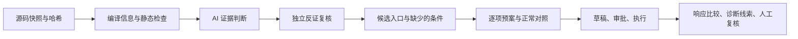

# 源程序扫描质量增强与验收

> 当前源码扫描已统一接入独立 CScan 服务，配置与验收以 [CScan 接入说明](cscan-integration.md) 为准。下文保留原静态工具与本地 AI 审计阶段的历史设计、测评及部署记录，不作为新扫描引擎的配置要求。

本次增加了对照测评、编译信息、证据与反证判断、预案可复现信息。实际工具和隔离流程已在实验室扫描服务器验收；真实项目的模型质量、部署程序验证和 ARM64 客户端发布仍待验收。

## 本次实现



- 编译上下文：读取指定的 `compile_commands.json`，把实际编译单元、宏、语言标准和项目内头文件目录交给 cppcheck。数据库未列入的源文件仍接受普通检查。
- AI 判断：分别保存输入控制、源码可达性、有效检查、缺少条件、支持代码和反证代码。肯定判断与否定判断均校验真实快照引用，兼容旧发现。
- 独立复核：对高优先级候选再作一次反证复核，每次最多六项、一个额外模型调用。优先寻找有效检查、安全生命周期和不可达分支；保留原始静态告警，覆盖记录显示失败、拒绝引用及超出预算的数量。
- 入口对应：提取已有证据片段中的同范围路由字符串，记录文件、行号；TCP 入口要求补充菜单或消息到函数的关系。字符串匹配和成功入口响应都不构成真实调用或污点传播证明。
- 可复现预案：保存源码快照、文件哈希和运行条件。步骤可设置响应文本、HTTP 状态码或同地址正常对照差异判定；执行证据保存正常对照编号、限制及版本信息。匹配条件不会自动标记为已验证漏洞。
- 诊断线索：识别实际响应中的 ASan/UBSan 报告，兼容有界 JSON 响应中的 `stdout` / `stderr`，关联唯一匹配的源文件。忽略响应中自述的“已验证”和结构化源码定位。响应可能含伪造或旧日志，必须核对目标日志及部署版本。平台没有自动编译或执行采集到的源程序。

分析覆盖、源码证据和执行复核窗口可以查看新增信息。运行条件进入预案说明和执行前检查。已接通的预案自动加入草稿、草稿恢复、审批快照执行、拓扑范围和 HTTP/TCP 分流继续保留。

## 配置编译信息

在扫描后端既有源码连接配置的 `analysis` 中加入相对路径。例如：

```json
{
  "id": "lab-program",
  "kind": "local",
  "source_root": "/opt/lab/project",
  "targets": ["http://192.0.2.10:8080/"],
  "analysis": {
    "platform": "unix64",
    "compile_database": "build/compile_commands.json"
  }
}
```

SSH 项目同样使用项目内相对路径；HTTP 项目可以读取源码目录下明确配置的相对地址。数据库最多 500 条；本地/SSH 读取最多 2 MiB，HTTP 最多 512 KiB。正常遍历忽略构建目录，但会单独只读采集明确指定的数据库。

编译命令仅被解析，绝不执行。编译器插件、响应文件、项目外路径和不支持的参数不会交给工具。工具使用冻结源文件和清洗后的数据库，容器无网络且只读挂载。缺数据库、未采集文件、项目外头文件、参数未接入都会记录覆盖缺口，并保留普通扫描结果。

CMake 项目可在原有构建方式中启用 `CMAKE_EXPORT_COMPILE_COMMANDS`。信息须对应实际部署版本、架构和宏配置。当前相关片段仍是有界词法检索，编译数据库接入不等于获得完整 AST、调用图或跨文件污点分析。

## 实际对照测评

执行 `cd backend && npm run benchmark:source -- --diagnostics --output ../build/source-quality-report.json`。静态检查需要 `rt-sast-c` 或已配置的宿主机静态工具；诊断部分需要本机 GCC/G++ 和 ASan/UBSan 运行库。

命令只编译仓库内六个受控样例和固定入口，在临时目录运行并清理，不编译采集的用户程序。样例涵盖越界写、空指针和释放后使用，各有一个修复对照。

2026-10-13 本地实际结果（实验室服务器的两个静态工具对照结果一致）：

| 检查 | 缺陷版检出 | 修复版告警 | 说明 |
| --- | --- | --- | --- |
| cppcheck | 3/3 | 0/3 | 三项均定位到已知缺陷附近 |
| Flawfinder | 1/3 | 1/3 | 漏掉空指针、释放后使用，对有长度检查的修复代码仍发告警 |
| ASan/UBSan 受控运行 | 3/3 | 0/3 | 六项诊断结果符合样例预期 |

报告按样例计算候选告警精度、召回、定位和修复版告警，并保存源文件哈希。仅三对样例，不能把这些比例当作真实项目准确率。Flawfinder 告警需要复核，不能单独证明漏洞。

缺陷匹配同时检查附近行号和样例允许的 CWE 分类，保留每条工具的实际分类与规则名。当前 cppcheck 对这三项分别返回 CWE-788、CWE-476、CWE-672；样例保留这些分类与通用分类，避免把分类表达差异当作未检出。

真实模型测评显式添加 `--ai`，通过现有 `LLM_API_KEY`、`LLM_BASE_URL`、`LLM_MODEL` 等环境配置连接模型。测评使用临时内存数据库，不读取生产数据库配置，不输出密钥。报告分别记录原始 AI 候选、反证复核后的候选指标和覆盖；未知条件候选仍计作告警。模型缺失或覆盖不足时 `ai_evaluated=false`，命令返回失败，不能把缺失结果视为安全。本次没有完成真实模型质量测评。

另行授权的固定六行样例已经完成真实模型分析、独立复核和预案生成，并走完草稿恢复、审批、真实本地请求及证据保存。最终三步预案保存三条证据，两个验证步骤取得实际诊断并满足可观察判定；格式和对照条件由一次有界纠正修复。这是单一样例的链路验收，不是上述六样例的模型质量测评，更不能代表用户项目准确率。详情见 [源码流程与环境](source-workflow-and-environment.md)。

## 环境缺口与后续验收

| 环境或信息 | 适用场景 | 当前结论 |
| --- | --- | --- |
| 后端可使用的 `rt-sast-c` 镜像 | 容器静态扫描 | 2026-10-13 已向实验室实际 Docker 引擎导入 amd64 镜像，两个工具和真实样例扫描通过；详见环境清单 |
| 对应版本的编译数据库和项目头文件 | 精确编译上下文 | 接入代码完成，真实项目需生成和配置；SDK 头文件须纳入授权项目快照范围 |
| 真实模型连接与配置 | AI 分析、复核、预案生成 | 已授权固定六行样例完成真实模型全流程验收；真实项目的准确率仍需对照测评 |
| 实际运行入口、输入规则、认证前提、部署版本 | 执行源码验证预案 | 必须逐项确认，不能用源码下载地址代替运行入口 |
| GCC/G++ 或 Clang、sanitizer 运行库、诊断构建及日志 | 内存或未定义行为诊断 | 本地受控 GCC 样例通过；目标架构、构建和日志接入待验收，普通 HTTP/TCP 请求无需此环境 |
| 网络通路及修复后的前后端部署 | 远端全流程 | 实验室连接已恢复；修复已在服务器隔离回归通过，正式前后端代码待用户手动 PR 合并和发布 |

基础环境详见 [源码流程与环境](source-workflow-and-environment.md)。

基础镜像已经补齐。手动合并并发布前后端后，分别以真实 HTTP、TCP 项目跑完扫描 → 证据/反证 → 逐项预案 → 草稿恢复 → 审批 → 正常对照/验证 → 人工复核。记录真实模型漏报、误报、调用前提和诊断，继续扩展跨文件、宏条件与安全检查样例。

完整 AST/污点分析、任意源码自动构建、目标侧 sanitizer 日志独立采集、覆盖率引导的模糊测试尚未实现。下一阶段需先确定目标架构、可重复构建方式、输入接口、隔离及资源预算再接入，不能仅靠补一个通用镜像获得。

## 修改范围与验证

扫描改动在 `backend/src/services/sourceAudit.js`、`sourceCollector.py`、`sourceSnapshot.js`、`sourceScanPolicy.js`、`sourceScanFindings.js`，新增编译、反证复核、入口对应和测评服务；预案与执行改动在 `sourceVerification.js`、`programAgent.js`、`executionEngine.js`、`preflightGate.js` 和 `backend/src/tools/toolRunner.js`。界面改动在 `frontend/src/pages/ScanPage.cpp` 与 `ExecutionPage.cpp`。新增测评入口为 `backend/scripts/source-benchmark.js`，新增与扩展回归位于 `backend/test/source-enhancement.test.js`、`source-audit.test.js`、`source-workflow.test.js`、`source-offline-workflow.test.js`，脚本登记在 `backend/package.json`。

验证命令：`SOURCE_TEST_SAST=1 npm test`、`npm run benchmark:source -- --diagnostics`、`cmake --build build -j2`、`ctest --test-dir build -R ui-context --output-on-failure`、`git diff --check`。后端共 242 项通过，包含真实静态工具、HTTP/TCP 全链路、旧数据、复核失败/取消、无效引用、预算、编译信息缺失、审批后的判定与证据关联、DVWA 与目录枚举模板和任务版本区分、模型 JSON 请求兼容、正常对照方法匹配；模型回复在回归中受控，不代表真实模型效果。Qt 构建与三种缩放下界面检查通过。构建保留既有 Qt 过时接口警告，没有新增编译错误。

验证日志和 JSON 测评报告保存在忽略的 `build/` 目录；本轮只向实验室导入缺失的静态工具镜像，不修改真实运行数据库，不创建迁移或部署未合并代码，也不覆盖工作区已有的其他改动。
