# 靶场测试全流程设计方向

整理日期：2026 年 10 月 16 日。依据：[10.13—10.16 开会要求](10.13-10.16开会要求.md)及后续项目讨论。

本文用于确定产品与实施方向，不作为功能已完成的证明。代码现状来自本次本地静态核对，未验证远端部署或实际靶场运行效果。图中描述的是拟建设流程，不是当前程序的实际调用图。

## 1. 范围与确认状态

已明确的范围及已获认可的方向：

- 本轮优先完成靶场测试全流程，暂不处理源程序全流程。
- 以“扫描结果—匹配载荷—逐漏洞攻击测试—统计与结论”为交付主线，先解决扫描覆盖及发现展示问题。
- 拓扑可以成为操作入口：点击节点查看资产，选择节点开展扫描，查看漏洞与验证状态。
- 拓扑区分实际探测关系、推断关系和手工绘制关系。
- 载荷与 Playbook 明确分工，具体定义见第 5 节。

本文提出的服务分流、状态、统计口径、页面组织和详细流程属于实施建议，需在后续实现时细化。会议既有 HexStrike 路线继续作为工具集成背景；具体适配链路仍应核验，不假定所有现有执行都已经经过 HexStrike。

## 2. 当前默认扫描安排及其局限

### 2.1 已核实的代码行为

当前自动任务的扫描阶段由 [pipelineEngine.js](../../backend/src/services/pipelineEngine.js) 中的 `runPipelineScan` 编排，初始分类来自 [targetProfileResolver.js](../../backend/src/services/targetProfileResolver.js)。

| 条件 | 当前默认扫描安排 | 说明 |
| --- | --- | --- |
| 被归为 Web 类：`dvwa`、`local_ip`、`web_url`、`web_app`、`rest_api`、`graphql_api`、`spa_app` | `port_scan` → `app_discovery` → `web_scan` | `local_ip` 也进入这个分支，不代表已证实存在 HTTP 服务。 |
| 其余类型，且未进入程序测试分支 | `port_scan` | 例如分类为 Windows/AD、云、普通域名或未知对象时，此阶段没有自动追加相应专用检查。 |
| 程序模式或以 `tcp://` 开头的目标 | 程序扫描或源码辅助扫描，再加端口扫描 | 属于另一分支，本轮暂不修改其完整流程；后续靶场 TCP 服务入口设计需避免与其混淆。 |

上述描述仅指自动任务的扫描阶段，不代表项目完全没有其他工具、手工扫描能力，或后续 Playbook 不会再执行扫描。

其他已核实事实：

- 扫描类型列表在执行前确定；结束时会汇总发现并更新目标画像，但这个扫描循环不会据此重新生成检查列表。
- Web 扫描先调用 Nikto，仅在提供 `parameters.sqli_url` 时追加 SQL 注入验证；当前自动编排给 Web 扫描传入空参数对象，因此此路径不会自动触发该追加验证。见 [scanExecutor.js](../../backend/src/services/scanExecutor.js)。
- 自动扫描列表没有默认纳入 `vuln_scan`、`api_fuzz`、`auth_audit` 等已有类型。
- 端口扫描已传入拓扑发现参数，可以在既有基础上完善流程，无需将拓扑当成完全独立的新模块。
- 扫描详情接口读取当前扫描任务全部已入库结果，前端分组列表遍历这些结果；这不能保证工具输出中的所有发现都已成功入库。
- 解析器跳过部分信息级或不匹配格式的输出；AI 分析最多读取 30 条结果。该上限针对 AI 分析输入，不是扫描结果列表条数上限。

### 2.2 为什么这样安排，是否有缺陷

从代码结构推断，这是一种预设流程：先识别端口，再识别应用，最后运行 Web 检查，容易串联演示。未核对历史设计决策，不能把这个推断写成原作者的确定意图。

对已经确认的 Web 目标，这个顺序可以作为起点；作为通用靶场扫描方案则有明显覆盖缺口：

1. **将地址类型当成服务类型。** 私有 IP 上可能同时存在 Web、SSH、SMB、数据库等服务，也可能没有 Web 服务。
2. **非 Web 自动覆盖不足。** 端口和版本发现完成后，仍需依据服务安排适用检查；只有端口扫描不能构成完整漏洞扫描。
3. **发现没有驱动后续计划。** 新发现的服务、接口及认证入口需要影响检查列表，不能只在扫描结束后生成摘要。
4. **同一主机无法用单一类别表达。** 应按主机下的多个服务和应用入口组织测试，不将整个靶场固定为 Web 或非 Web。
5. **工具存在不代表流程已经接入。** 工具选择、参数准备、结果解析、失败处理和覆盖记录必须一起完成。

建议采用：**任务范围 → 资产与服务发现 → 按实际服务生成检查计划 → 执行与记录覆盖 → 根据范围内新发现有限补充检查**。AI 可以辅助建议，系统负责适用性、范围、预算与状态校验。

### 2.3 拟议的服务分流

以下是目标行为，不声明这些分支目前均已实现或验证。

| 实际发现 | 后续检查方向 | 缺少条件时的处理 |
| --- | --- | --- |
| HTTP/HTTPS 应用 | 指纹、路径及表单发现、会话状态、适用漏洞检查 | 标记不可达、认证缺失或入口覆盖不足。 |
| REST/GraphQL 等 API | 接口与参数发现、角色与权限检查、适用输入验证 | 缺少接口定义或账号时记录覆盖缺口。 |
| SSH、SMB、FTP、数据库等非 Web 服务 | 协议识别、版本与配置检查、适用漏洞验证 | 按工具和前置条件明确支持范围；不默认开展口令攻击。 |
| Windows/AD 或靶场内云模拟服务 | 按实测身份和任务范围选择专用检查 | 不仅凭主机名、私有 IP 或域名猜测服务类型。 |
| 未知或不支持服务 | 保留资产、端口、证据及待人工识别项 | 明确“未覆盖”，不能记为“安全”。 |
| 同一主机存在多种服务 | 分别建立服务检查项，汇总到同一资产 | 不强制只选择一个分支。 |

## 3. 覆盖与结果完整性

正式覆盖要求见会议要求文档第 4.3.1 节。实施时建立“资产／入口—检查项—运行记录—发现—证据”的关联。

逐层核对以下链路：

`工具结果 → 解析记录 → 标准化与去重 → 持久化 → API 返回 → 页面完整列表 → 统计`

- 分别统计原始发现、解析成功、未解析、过滤、合并、入库及展示数量。各层因合并等原因不必数量相等，但差异必须有解释。
- 工具只有文本输出时，保留必要的脱敏证据并标注解析覆盖未知，不把每一行输出都计为漏洞。
- 失败、超时或中止时保留可用的部分结果，标明完整性；不要因工具非正常结束而将已产生的有效发现全部丢弃。
- AI 摘要或推荐只引用完整发现集中的记录；如输入分批或截断，明确处理范围，不静默用摘要代替全量发现。
- 信息级发现、端口、指纹、漏洞候选和执行错误分别可查；漏洞表不隐藏“没有载荷”或“暂时无法验证”的条目。
- 漏洞实例建议按资产、服务／入口、位置／参数与漏洞标识关联去重；保留各工具原始 ID 和证据，具体规则待实现时确定。

## 4. 拓扑的位置与交互

靶场列表是已登记测试环境的入口；拓扑展示选定范围内发现的资产及关系。网络探测不能自动保证发现所有靶场或所有资产。

建议从任务内进入拓扑：

1. 新建任务时选择靶场、范围及扫描执行位置。
2. 资产发现后形成初始拓扑；明确的单应用 URL 允许直接建立应用节点并继续检查，不强制先完成整网发现。
3. 点击节点查看主机、服务、应用入口、证据及覆盖状态；选择范围内节点发起扫描。
4. 扫描和验证结果回填节点，分别展示发现数、严重程度、覆盖缺口和验证状态。
5. 多种服务归属同一主机；网络路由关系、应用访问关系与资产归属关系使用不同语义，不混用。

| 关系来源 | 展示要求 |
| --- | --- |
| 实际探测 | 显示证据类型、探测位置和时间；标明是路由路径、应用可达还是其他关系，不泛化为物理直连。 |
| 推断 | 明确“推断”标签及依据，使用独立线型。 |
| 手工绘制 | 明确“手工”标签及备注，不算作已验证连接。 |

拓扑中的新节点不自动扩大任务范围；只展示或登记待补充范围的对象，不直接继续测试。只获得局部路径或局部可达性时，应明确拓扑的不完整性。

## 5. 漏洞、载荷、Playbook、工具和 AI 的分工

| 对象 | 职责 | 需要关联的数据 |
| --- | --- | --- |
| 漏洞发现 | 描述哪里可能存在什么问题及依据 | 资产、入口、位置、来源、证据、置信度与验证状态。 |
| 载荷 Payload | 验证步骤实际使用的请求内容、参数值、测试文件等输入 | 类型、内容或模板、适用条件、变量、版本、来源与验证记录。 |
| Playbook | 组织准备、验证、证据检查及清理步骤 | 前置条件、工具、载荷引用、参数、成功判据、失败和停止条件。 |
| 执行器与工具适配 | 将计划转成实际调用，采集输出并控制状态 | 执行目标、步骤、实际输入的脱敏记录、超时、中止与证据。 |
| AI | 辅助分析、匹配、生成与调整建议 | 所引用的发现、建议理由、生成版本、校验结果及调整记录。 |

一个 Playbook 可以使用多个载荷，一个载荷可以被多个 Playbook 复用；部分检查无需独立载荷，部分工具在内部生成输入。选择漏洞后的主要执行单位建议为验证 Playbook，所需载荷由具体步骤消费。

当前项目的载荷对象也包含执行命令／步骤，不能直接假定它们都已经是纯输入数据。后续应明确载荷类型及消费方式，兼容现有数据，避免将整段命令盲目当作某工具的参数。

现有 [playbookCompiler.js](../../backend/src/services/playbookCompiler.js) 支持步骤引用 `payload_id`，但实际使用仍需验证：载荷如何进入请求、参数或文件，以及执行记录能否关联具体载荷版本。仅在步骤上挂一个 ID 不足以证明载荷被执行使用。

## 6. 直观的载荷生成与逐漏洞验证

### 6.1 载荷生成体验

现有 [PayloadPage.cpp](../../frontend/src/pages/PayloadPage.cpp) 已有管理员可见的“智能生成载荷”入口；[payloadGenerator.js](../../backend/src/services/payloadGenerator.js) 将生成结果保存为候选。当前入口主要根据分类生成，尚不能据此认定已打通围绕具体漏洞的完整演示。

建议在漏洞详情内完成以下操作：

1. 检索已有载荷，并展示适用条件、匹配依据及历史验证情况。
2. 无合适载荷且验证确实需要时，带入具体漏洞证据、目标入口和约束，生成候选。
3. 展示生成状态、内容预览、变量、拟使用步骤及校验结果；无需展示模型内部推理正文。
4. 按平台角色规则处理候选审核和可用状态；生成失败或内容不适用时保留原因，不伪造成功结果。
5. 执行时锁定载荷及 Playbook 版本，记录是否实际消费载荷；敏感运行值不写入通用载荷模板。
6. 展示实际结果并保存可复用模板，运行证据单独关联。

“本次新生成／本次开始前已有”和“候选／可用／已验证”是不同维度。前者用颜色与文字区分；下一次任务读取已保存载荷时按已有载荷展示，仍保留其 AI 来源和历史有效性记录。

### 6.2 执行与 AI 边界

建议以 Playbook 组织步骤、工具消费载荷、AI 辅助决策，优先实现可解释、可重复的逐漏洞验证。现有 [executionEngine.js](../../backend/src/services/executionEngine.js) 已包含编译、工具调用和 ReAct 分支，后续应在现有架构中明确约束与记录方式。

- 执行前展示目标漏洞、操作对象、前置条件、计划步骤、载荷及成功判据。
- AI 生成或调整的步骤需通过结构、变量、工具适用性和任务范围校验；不能跳过执行器直接操作目标。
- 范围内补充步骤应有次数、时间和重试限制，保存计划变更；无法继续时标为待补条件或未能验证。
- 工具退出成功只表示调用层面的结果，漏洞是否成立由实际证据及预先定义的判据决定；AI 解释不是成功证据。
- 发现新资产或新漏洞时回到对应发现和计划环节，避免把另一项发现算作当前漏洞的验证成功。

## 7. 从新建任务开始的完整详细流程图

图片版：[分阶段图片目录](靶场测试流程图/README.md) · [完整 PNG](靶场测试流程图/00-完整流程.png) · [可放大的 SVG](靶场测试流程图/00-完整流程.svg)。

下图覆盖正常、缺失条件、部分失败、取消、恢复及复测路径。多个服务分支按适用性分别进入，允许同一资产走多个分支。扫描期间展示进度及阶段状态，结束后集中展示发现；异常时保留已有结果。

此 Mermaid 图用于仓库讨论和方向评审；正式需求／设计文档中的图仍按会议要求使用 UML 专用软件绘制。

```mermaid
flowchart TD
    subgraph S1[一 新建任务与范围准备]
        A0["新建任务：名称、目标、负责人及测试目的"] --> A1["选择已登记靶场或填写目标入口"]
        A1 --> A2["记录靶场版本、资产基准与已知漏洞清单；未知项标注未知"]
        A2 --> A3["确定地址与入口范围、排除项、扫描位置、允许操作及时间预算"]
        A3 --> A4["引用所需认证配置；设置检查策略及停止条件"]
        A4 --> A5["预检连接、工具能力、环境基线与恢复条件"]
        A5 --> A6{"具备本次运行条件？"}
        A6 -->|否| A7["保存草稿或标记阻塞；列出缺失条件"]
        A7 -->|补齐后重新预检| A5
        A6 -->|是| A8["保存任务配置及本次运行版本，开始任务"]
    end

    subgraph S2[二 资产发现与拓扑入口]
        A8 --> B0{"输入范围形式？"}
        B0 -->|网段或主机集合| B1["发现授权范围内主机、端口与服务；记录不可达对象"]
        B0 -->|明确应用或服务入口| B2["确认指定入口可达性与协议；不自动扩大到整网"]
        B1 --> B3["建立资产、服务和入口清单；保留探测位置、时间及证据"]
        B2 --> B3
        B3 --> B4["形成初始拓扑；区分实测、推断、手工及关系类型"]
        B4 --> B5["点击节点查看资产，选择本次检查对象"]
        B5 --> B6["识别每个服务和应用入口；同一资产允许多种服务"]
    end

    subgraph S3[三 按服务形成检查计划]
        B6 --> C0{"逐服务判定适用检查"}
        C0 -->|Web| C1["识别应用、路径、表单、参数与认证状态"]
        C0 -->|API| C2["识别接口、参数、角色及认证条件"]
        C0 -->|非 Web 协议| C3["识别协议、版本及适用配置和漏洞检查"]
        C0 -->|AD 或云模拟服务| C4["按实际身份、权限及工具能力选择专用检查"]
        C0 -->|未知或不支持| C5["登记未覆盖项、依据及人工补充需求"]
        C1 --> C6["汇总资产与入口检查矩阵；标注缺少条件及不适用项"]
        C2 --> C6
        C3 --> C6
        C4 --> C6
        C5 --> C6
        C6 --> C7["校验范围、前置条件、重复项与执行预算；形成扫描计划"]
    end

    subgraph S4[四 扫描执行与全量结果]
        C7 --> D0["执行适用检查；界面展示进度及阶段状态"]
        D0 --> D1["逐项记录完成、失败、超时、中止或跳过；保留部分结果"]
        D1 --> D2["脱敏证据、解析、标准化和去重；记录未解析及合并原因"]
        D2 --> D3["入库并核对工具、解析、存储、接口和展示各层差异"]
        D3 --> D4{"存在范围内新入口，且仍有检查预算？"}
        D4 -->|是| D5["更新资产与覆盖矩阵，补充尚未执行的检查"]
        D5 --> C7
        D4 -->|否| D6["扫描阶段收束：完整、部分完成、失败或中止"]
        D6 --> D7["集中展示全部发现、信息、证据、错误及覆盖缺口"]
        D7 --> D8["将扫描与覆盖状态回填拓扑节点"]
    end

    subgraph S5[五 选择漏洞与验证方案]
        D8 --> E0{"选择本次需要验证的漏洞？"}
        E0 -->|无发现或不验证| G0
        E0 -->|选择具体漏洞实例| E1["查看入口、位置、证据、置信度及已有验证记录"]
        E1 --> E2["匹配适用 Playbook 与成功判据"]
        E2 --> E3{"是否有适用方案？"}
        E3 -->|否| E4["AI 辅助或人工编制候选方案；通过结构及适用性校验"]
        E4 --> E5{"候选方案可用？"}
        E5 -->|否| EX["标记待补条件或无法验证，并保留原因"]
        E5 -->|是| E6
        E3 -->|是| E6{"方案需要独立载荷？"}
        E6 -->|否或工具内部生成| E12
        E6 -->|是| E7["检索载荷库，核对漏洞、入口、前置条件及版本"]
        E7 --> E8{"已有适用载荷？"}
        E8 -->|是| E11["绑定载荷版本及步骤变量，标记本次来源"]
        E8 -->|否| E9["基于漏洞证据生成候选载荷；展示内容、变量与拟使用步骤"]
        E9 --> E10{"通过内容校验及平台可用性规则？"}
        E10 -->|否| EX
        E10 -->|是| E11
        E11 --> E12["汇总可执行计划：目标、步骤、实际输入、成功判据及清理动作"]
        E12 --> E13{"范围、认证、工具、变量及预算齐备？"}
        E13 -->|否| EX
        E13 -->|是| E14["按任务执行策略启动；锁定 Playbook 与载荷版本"]
    end

    subgraph S6[六 执行验证与证据判定]
        E14 --> F0["执行器通过工具适配调用工具；步骤消费所绑定载荷"]
        F0 --> F1["采集实际调用、输出、载荷使用关系及脱敏证据"]
        F1 --> F2{"执行异常或证据不足，需要调整？"}
        F2 -->|是| F3{"存在范围内可执行调整且仍有预算？"}
        F3 -->|是| F4["记录 AI 或人工建议；校验变更并保存新计划版本"]
        F4 --> E12
        F3 -->|否| F5["根据原因记录执行异常、中止或未能验证"]
        F2 -->|否| F6["按成功判据判断验证成立或未能验证；必要时人工复核"]
        F5 --> F7["关联漏洞、执行尝试、计划版本、载荷版本及证据"]
        F6 --> F7
        F7 --> F8["回填漏洞列表与拓扑；记录新发现及待补检查项"]
        F8 --> F9{"还有选定漏洞需要验证？"}
        EX --> F9
        F9 -->|是| E1
        F9 -->|否| G0
    end

    subgraph S7[七 统计、报告、恢复与复测]
        G0["汇总资产覆盖、检查覆盖、去重发现及验证结果"] --> G1["对照已知漏洞基准；未知分母不计算发现率"]
        G1 --> G2["生成统计图表、结论及报告；列出未检查、失败和待复核项"]
        G2 --> G3["归档必要证据与配置版本，执行计划内清理及环境恢复"]
        G3 --> G4{"环境恢复并通过基线核对？"}
        G4 -->|否| G5["标记恢复失败、环境不可复用；保留证据并处理问题"]
        G5 -->|问题解决后重新恢复| G3
        G4 -->|是| G6{"需要复测或重复演示？"}
        G6 -->|是| G7["新建关联运行，保留旧结果；重新确认范围与条件"]
        G7 --> A5
        G6 -->|否| G8["归档任务；分别记录测试完成度与环境可复用状态"]
    end

    A8 -.运行期间可取消.-> X0["取消：停止派发并中止可中止调用，记录未停止项和已有结果"]
    X0 --> X1["确认调用已结束或隔离运行影响；标记未执行检查与未验证漏洞"]
    X1 --> G0
```

流程补充：

- 各阶段发现范围外目标时，只记录线索；扩展范围须形成明确的任务范围变更，不能由 AI 自行扩展。
- 发现新漏洞时先登记独立发现；如需测试，回到选择漏洞与生成方案环节。新入口引发的补充扫描也需记录计划版本与预算。
- 调整与重试有上限，不能通过循环无限扫描或生成；用户取消后不再进入自动补扫或验证循环。
- 恢复操作只能在相关调用停止或影响已隔离后执行；恢复失败不能把任务标为“环境已就绪”。
- 图中环境基线、清理和恢复均指本任务明确范围内的虚拟环境操作，不授权会议记录中对象尚未明确的格式化操作。

## 8. 状态、统计与可重复性

建议分别记录扫描状态、漏洞验证状态及环境恢复状态，避免一个“成功”覆盖所有含义。

| 维度 | 建议状态／口径 |
| --- | --- |
| 检查执行 | 待执行、执行中、完成、失败、超时、中止、跳过；每种非完成状态有原因。 |
| 漏洞验证 | 未执行、待补条件、执行中、验证成立、未能验证、执行异常、中止；人工确认误报需单独结论及依据。 |
| 载荷 | 来源、是否本次新生成、候选／可用状态及历史验证结果分别记录。 |
| 环境 | 基线已记录、待恢复、恢复中、恢复成功、恢复失败；不以删除环境作为恢复成功依据。 |

建议统计：

- 已发现资产与已检查资产；基准未知时只报告数量及范围说明。
- 计划检查项、已完成项、失败／跳过项及未支持项。
- 去重漏洞实例数、已执行验证的漏洞实例数、验证成立数、未能验证数和执行异常数；执行尝试次数另计。
- 基准漏洞发现率：与已知清单正确匹配的发现数／当前版本及范围内已知漏洞数。无法确认匹配或分母时不计算，分母为零时标为不适用。
- 验证成立比例：验证成立的漏洞实例数／已执行验证的漏洞实例数，同时展示分母、异常及未能验证数，不将其解释为整体安全水平。

每次运行锁定靶场版本、测试范围、检查策略、Playbook 与载荷版本；复测创建关联运行，保留旧证据。发现数、工具成功数和漏洞验证成功数分别统计。

## 9. 建议实施顺序与待落实事项

1. **扫描覆盖与完整展示。** 选定靶场基准，逐层对账当前结果；修复静默丢失，展示覆盖矩阵，建立按服务安排检查的最小路径。
2. **拓扑与任务联动。** 复用已有拓扑能力，关联资产、服务和入口，支持节点查看、范围内扫描及状态回填。
3. **逐漏洞验证闭环。** 关联具体发现、Playbook、载荷和证据，完成已有载荷复用及单漏洞验证。
4. **直观载荷生成。** 在真实缺失载荷的场景接通候选生成、校验、保存、实际使用与下次复用。
5. **统计及重复演示。** 统一分母、去重和成功判据，验证恢复及关联复测，形成会议演示和文档初稿。

开始实现前需落实的具体输入：用于首轮验收的靶场及版本、授权测试范围、资产与已知漏洞基准、可用认证条件、首批服务类型和检查项、单漏洞验证成功判据、环境恢复方式。未知项先显式记录，不将建议当作已确认运行条件。

本次仅更新方向文档及覆盖要求，没有变更扫描器、执行引擎、数据库或运行环境，也没有开展实际扫描和攻击验证。
